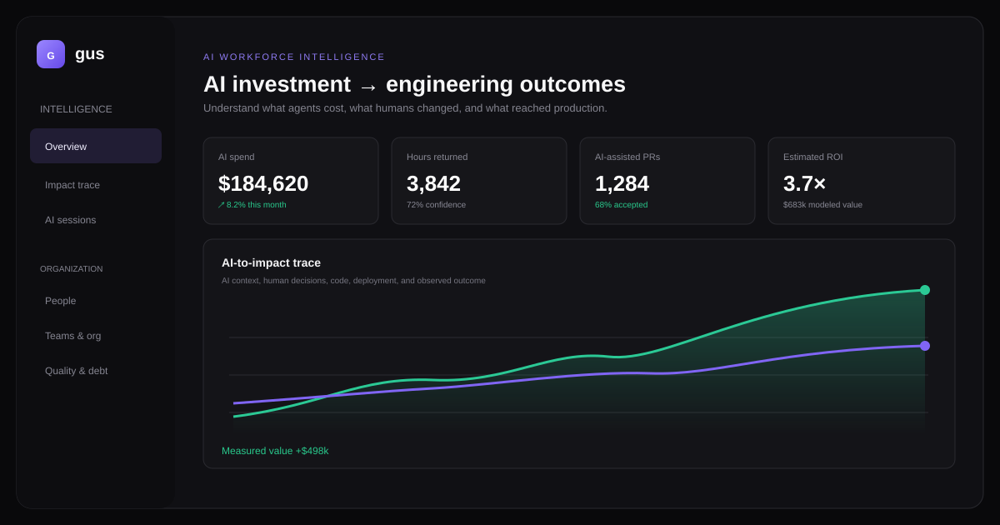

# Gus Cloud — Datadog for AI-Powered Engineering

> Observe how engineers and AI agents work together—from prompt to production.

Traditional observability explains what software is doing. Gus Cloud explains
how software work gets done: which AI context was used, what an agent changed,
where a human intervened, how the change moved through review and deployment,
and whether it produced a measurable engineering outcome.

Gus helps engineering organizations understand what their AI investment actually
produces. It connects AI sessions and context to code changes, human decisions,
pull requests, deployments, quality signals, and measurable outcomes.

This hackathon demo is built on **Gus**, an open-source project that began as
**Git for AI Context**: an append-only history of AI conversations, decisions,
context changes, and agent work that evolves alongside source code.

The prototype asks a simple question:

> We are spending millions on AI tools and agents—but what measurable value are
> we actually getting?

**[Open the live demo](https://gbabaisaac.github.io/gusCloud/)**

## Why “Datadog for engineers”?

Datadog connects infrastructure signals into one operational picture. Gus Cloud
does the same for AI-powered engineering work:

| Observability question | Gus Cloud evidence |
| --- | --- |
| What happened? | Prompts, context versions, agent actions, code diffs, PRs, and deployments |
| Who or what contributed? | Human edits, AI generation, reviews, architecture, and manager enablement |
| What did it cost? | Model, tokens, session cost, retries, and engineering time |
| Did it work? | Accepted changes, rework, incidents, quality, latency, and business outcomes |
| Can we prove it? | Linked evidence with confidence levels and correlation/causation boundaries |

Gus Cloud is not employee surveillance and does not calculate intrinsic human
worth. Its impact signals are explainable lenses for investigation, coaching,
and organizational learning—not automated personnel recommendations.



## What the demo shows

- **Executive intelligence:** AI spend, token usage, hours returned, assisted
  pull requests, rework, and modeled ROI.
- **Agent observability:** inspect sessions, models, cost, tool activity, files,
  retries, and engineering outcomes.
- **AI-to-impact trace:** follow one AI request through a human correction,
  pull request, deployment, and observed performance improvement.
- **Code evolution diffs:** compare AI-generated code with human corrections,
  understand why it changed, and link the exact diff to downstream evidence.
- **Engineering impact profiles:** explain delivery, quality, architecture,
  collaboration, and AI leverage without reducing people to output rankings.
- **Workforce intelligence:** explore all 50 simulated engineers, managers,
  AI spend, sessions, PRs, reviews, quality, rework, value signals, and protected
  prompt history through configurable evidence-based sorting.
- **Organization intelligence:** explore team health, spend, outcomes, reporting
  structure, and cross-team dependencies.
- **AI quality and debt:** identify recurring model mistakes, corrections,
  code churn, and downstream rework.
- **Dark and light themes:** use the sun/moon control in the top-right corner.

All people, teams, costs, and outcomes in the dashboard are clearly marked as
simulated. The product does not claim to determine employee worth or recommend
personnel actions.

## Run the hackathon demo

No package installation or API keys are required.

```sh
git clone https://github.com/gbabaisaac/gusCloud.git
cd gusCloud/web
python3 -m http.server 4173
```

Open [http://127.0.0.1:4173](http://127.0.0.1:4173).

## Three-minute demo script

1. **Start on Overview.** Frame the problem: AI adoption is growing faster than
   organizations can measure its effect. Change the KPI team and time scope to
   show that leadership can investigate spend and modeled value.
2. **Open AI sessions.** Search for Maya or filter by agent/outcome. Open a row
   to show cost, tokens, files, retries, the execution timeline, and prompt
   access controls.
3. **Open Impact trace.** Click each stage from AI session to production outcome.
   Open the AI → human diff, emphasize the query correction, and explain the
   difference between supported correlation and proven causation.
4. **Open Workforce intelligence.** Filter the complete team, change the impact
   dimension, and open a person or manager to inspect prompts, sessions, PRs,
   reviews, quality, and value evidence.
5. **Open People.** Show how architecture, review, mentoring, incident
   prevention, and automation count alongside delivery.
6. **Open Teams & org.** Point out the Platform review bottleneck and the Growth
   team spend/outcome imbalance.
7. **Finish on Quality & debt.** Show that apparent AI velocity can hide rework,
   recurring mistakes, and technical debt.

Recommended story: an engineering leader starts with an ROI question, discovers
an expensive low-output pattern, then uses the impact trace to see exactly where
AI helped, where human judgment mattered, and what evidence supports the result.

## Demo architecture

The dashboard is dependency-free HTML, CSS, and JavaScript in `web/`, making it
easy to run locally or publish as a static site. The underlying Gus CLI is written
in C and stores append-only event and checkpoint history in SQLite.

```text
Employee → AI session → Prompt/context → Agent actions → Code/PR
         → Deployment → Engineering outcome
```

## Hackathon scope

The dashboard currently uses realistic fictional fixtures. Production work would
add approved tool integrations, authentication and role-based access, durable
telemetry ingestion, and organization-specific attribution models.

## Project structure

```text
web/      Interactive observability demo
src/      Open-source Gus CLI and event store
tests/    CLI and storage integration tests
docs/     Repository assets
```

## Why open source?

AI context is becoming part of the engineering record. Teams should be able to
inspect, version, and own that history instead of leaving it trapped inside one
model vendor or editor. Gus provides the open foundation; the observability demo
shows what becomes possible when that context is connected to engineering data.

## Contributing

Issues and pull requests are welcome. Please keep changes focused, add regression
coverage for CLI behavior, and avoid committing real prompts or sensitive company
telemetry.

## License

MIT — see [LICENSE](LICENSE).

## Git context CLI

Gus is a small C command line companion for Git. `gus init` creates a local
`.gus` store with an append-only SQLite event history.

Build with CMake when available:

```sh
cmake -S . -B build
cmake --build build
ctest --test-dir build --output-on-failure
```

On systems with a C compiler and SQLite development library, CMake is optional:

```sh
cc -std=c11 -Wall -Wextra -Wpedantic src/main.c src/event_store.c src/checkpoint_store.c src/object_store.c src/git_capture.c -lsqlite3 -o gus
sh tests/integration.sh ./gus
sh tests/git_capture_integration.sh ./gus
cc -std=c11 -Wall -Wextra -Wpedantic -Isrc tests/event_store_api.c src/event_store.c -lsqlite3 -o event_store_api_test
./event_store_api_test
cc -std=c11 -Wall -Wextra -Wpedantic -Isrc tests/object_store_api.c src/object_store.c src/event_store.c -lsqlite3 -o object_store_api_test
./object_store_api_test
cc -std=c11 -Wall -Wextra -Wpedantic -Isrc tests/checkpoint_store_api.c src/checkpoint_store.c src/event_store.c -lsqlite3 -o checkpoint_store_api_test
./checkpoint_store_api_test
```

Run `gus init` in a project directory, then `gus status` or `gus log` from that
directory or a nested directory. `gus log` lists Gus events newest first, with
their timestamp, event type, and Git commit when recorded. Within a Gus project,
`gus log` takes no arguments. Outside a Gus project, it passes through to Git,
including all Git log options. `gus --version` prints the program version. Other
commands, including `gus branch`, pass their original arguments to Git.

`gus checkpoint` records a pointer-only checkpoint from any directory in the
project. Each checkpoint has a numeric ID, the previous checkpoint ID, the
current Git commit and branch, the latest decision event ID if any, the ID of
its own `CHECKPOINT` event, and a UTC creation time. It stores no file snapshot,
payload, or conversation. An unborn branch has no Git commit; detached HEAD has
no branch. Running the command repeatedly creates distinct checkpoints, even
when Git has not changed. `gus log` shows every event as before and annotates
checkpoint events with the checkpoint ID, parent checkpoint, branch, and Git
commit (or `(unborn)`). The event and checkpoint rows commit together.

`gus init` installs `post-commit` and `post-checkout` Git hooks. Existing hooks
are retained in adjacent `.gus-original` files and run first with their original
positional arguments, standard input, output, and exit status. Gus capture is silent and
does not change the original hook's result. A pre-existing hook sees its
`.gus-original` path as `$0`. The hooks invoke the absolute path
of the Gus executable used for `gus init`; run `gus init` again if that binary
moves. Gus records a `GIT_COMMIT` or `GIT_CHECKOUT` event and a pointer-only
checkpoint for each observed Git state change. Gus repository commands also compare
the current HEAD and branch with its last captured state. This catches changes
missed when a hook is removed or Git is used by another tool; repeated commands
do not add duplicate automatic checkpoints. If several changes occur before Gus
runs again, reconciliation can capture only the final observable state. Explicit
`gus checkpoint` still creates a new checkpoint each time.

`gus object put <file>` stores a file by its SHA-256 content hash and prints
the 64-character lowercase hash. Use `gus object put -` to read binary data
from standard input. Objects live at `.gus/objects/<first-two-hex>/<remaining-hex>`.
Putting identical content again reuses the existing object after verifying it;
objects are never overwritten. The C API in `src/object_store.h` accepts a
byte buffer or file descriptor, including empty data and embedded zero bytes.
Pass its returned hash as `payload_hash` when appending an event that refers
to an object.

The event store supports `PROJECT_INIT`, `GIT_COMMIT`, `GIT_CHECKOUT`,
`DECISION_CREATED`, `DECISION_SUPERSEDED`, `AGENT_STARTED`, `PROMPT`,
`AGENT_RESPONSE`, `FILE_EDIT`, and `CHECKPOINT`. Events have a stable numeric ID,
UTC timestamp, parent event ID, and optional `git_head`, `gus_head`,
`payload_hash`, and payload fields. `parent` links each new event to the previous
event. `gus_head` is reserved for a Gus snapshot reference. The C event store API
only appends; SQLite triggers reject updates and deletes. `gus init` upgrades the
original `kind`/`created_at` table in place, preserving row IDs and timestamps.
It also adds the append-only checkpoints table to existing Gus databases.
